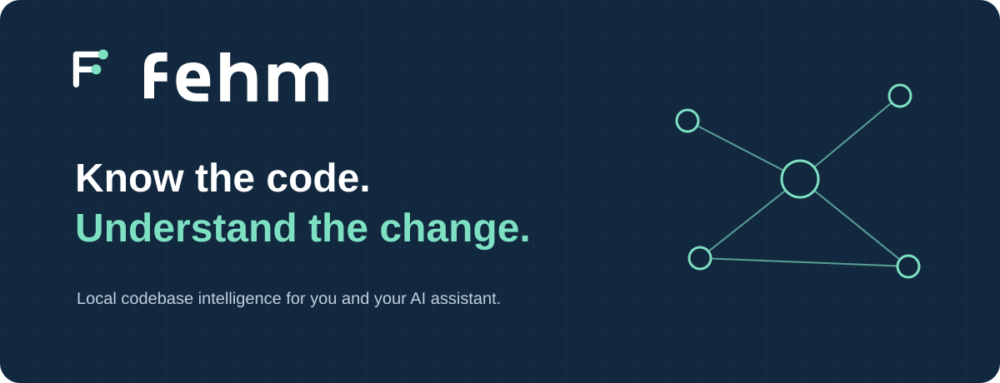

<p align="center">
  
</p>

# FEHM

**Local codebase intelligence for developers and coding agents.**

FEHM turns a repository into a searchable graph of files, symbols, imports and calls. Explore the code in a local dashboard, give your assistant focused source context, and investigate changes with evidence linked to the code.

[Documentation](docs/README.md) · [Quickstart](docs/guides/quickstart.md) · [Assistant integrations](docs/INTEGRATIONS.md) · [MCP](docs/guides/mcp.md) · [Contributing](#development) · [License](LICENSE)

> **First release: 1.0.0.** Available on PyPI. npm publication is pending. See [release status](docs/RELEASE_STATUS.md) for validation and remaining gates.

## Why FEHM?

- **Understand unfamiliar code.** Follow symbols and relationships, inspect architecture, and read explanations tied to source locations.
- **Give agents relevant context.** Retrieve focused code under an estimated token budget and select useful workflows from the bundled skill catalog.
- **Review changes with evidence.** Inspect architectural drift, static security findings, project health, Git history and verification records.
- **Work locally.** Core indexing and retrieval run without a model provider. Use the CLI, localhost dashboard or optional MCP server.

FEHM reports what static analysis can establish. Dynamic behavior and incomplete language coverage remain explicit limitations.

## Installation

Install [uv](https://docs.astral.sh/uv/getting-started/installation/), then install FEHM from PyPI:

```sh
uv tool install fehm
uv tool update-shell
fehm --version
fehm doctor
```

The wheel includes the compiled engine and its JavaScript dependencies. A pinned dependency supplies private Node.js, so end users need neither a FEHM checkout nor a separate Node/npm installation.

Installed-artifact testing currently covers **macOS ARM64 with Python 3.11**. Other platforms remain unverified. Your project's dependencies, Git and test tools are separate. See [installation](docs/guides/installation.md) for prerequisites, updates and removal.

## Quickstart

Run FEHM in your own repository:

```sh
cd /path/to/your/project
fehm scan .
fehm search "authentication"
fehm context "authentication flow" --budget 4000
fehm serve --port 7332
```

Open **http://127.0.0.1:7332** to explore the graph and analysis views. Stop the server with Ctrl+C. Project state is stored in `.fehm/`.

## What you can do

| Workflow | Capability |
| --- | --- |
| Understand source | Search files and symbols, inspect relationships, trace outgoing calls and explore the codebase graph. |
| Explain architecture | Read source-linked briefings and architecture views that distinguish observed evidence from inference. |
| Prepare assistant context | Select relevant source and optional workflow skills within estimated token budgets. |
| Route and install skills | Discover the bundled catalog and install selected workflows with customization protection. |
| Inspect architectural drift | Compare structure with explicit constraints and detected conventions. |
| Review health and security | Inspect tests, supplied coverage, dependencies, static security signals and engineering readiness. |
| Analyze prompts | Inventory prompts and tool contracts; evaluate supplied cases and outputs. |
| Explore Git history | Search changes, compare revisions and inspect historical analysis snapshots. |
| Explore engineering concepts | Look up concepts and their supporting evidence in the codebase. |
| Verify changes | Analyze working-tree impact and record explicitly approved checks in the verification ledger. |
| Investigate failures | Connect errors and source locations to evidence, tentative hypotheses and diagnostic actions. |

See the [guides](docs/README.md) for each workflow and its limitations. A standalone revision-aware Change Impact Engine is not part of 1.0.0.

## Connect your coding assistant

Install FEHM first, scan your project, then add the entry skill:

```sh
fehm install --platform claude --project
fehm integrations --platform claude --project
```

Choose `claude`, `cursor`, `codex`, `gemini`, `copilot`, `vscode` or `generic`. Omit `--project` for personal scope. Preview with `--dry-run`; remove with `fehm uninstall --platform claude --project`. Customized files are protected.

For optional direct tool access, generate the configuration for your client:

```sh
fehm mcp-config --platform claude --root /absolute/path/to/your/project
```

This prints configuration for review; it does not change assistant settings. The read-only MCP server exposes context, search, focus, relationships, a system map and static project-health findings. It requires a fresh saved graph.

CLI installation, skill installation and MCP setup are separate steps. Follow the [client guides](docs/INTEGRATIONS.md) and [compatibility matrix](docs/REAL_TESTING.md). Claude Code connection is verified; Codex configuration is accepted. Full assistant sessions and other clients remain unverified.

### Select workflow skills

The entry skill teaches an assistant how to use FEHM. Catalog skills provide additional workflows and are installed separately:

```sh
fehm skills list --source superpowers
fehm skills route "Debug a failing authentication test" --budget 2500
fehm agent-context "Debug authentication" --skill debugging/systematic-debugging
fehm skills install debugging/systematic-debugging --platform codex --project --dry-run
fehm skills install debugging/systematic-debugging --platform codex --project
```

[Superpowers workflows](docs/integrations/superpowers.md) include planning, TDD, debugging and verification resources. Use `--exclude-source superpowers` on routing/context requests to exclude that source, or `--no-skills` with `agent-context` for code-only context. Hosts control discovery and invocation; installing files does not guarantee an assistant follows them. See [skill routing](docs/guides/skills.md).

## Evidence and privacy

TypeScript and JavaScript analysis uses the TypeScript compiler. Python, Go, Rust and Java have shallower heuristic coverage. Graph edges do not prove runtime behavior, and context budgets estimate tokens rather than billing usage.

Ordinary scanning, retrieval and skill routing do not call an LLM. Explicitly configured summaries, reranking and external lookups can use network services. Project-command execution requires approval through the supported verification workflow; host execution is not sandbox isolation. Static findings do not certify security or production readiness. A discovered test is not a passing test result; strict TDD evidence currently supports Node TAP assertions.

Read [security and privacy](docs/guides/security.md), [verification](docs/guides/verification.md) and the [security policy](SECURITY.md).

## Build from source

For contributors or users who prefer a source checkout, use Node.js 22.13 or newer. The release workflow targets Node 24. Git is needed to clone the repository and use history workflows.

```sh
git clone https://github.com/amirhamzakhan2001/fehm.git
cd fehm
npm ci
npm run build
node dist/cli.js help

# Optional: make the fehm command available on PATH
npm link
```

Then use the quickstart from your target repository. Without `npm link`, run `node /absolute/path/to/fehm/dist/cli.js scan --root /absolute/path/to/project`.

## Development

```sh
npm ci
npm run check
npm run build
npm test
npm --prefix website run check
```

For wheel construction and installed-artifact validation, install Python and uv, then run `npm run release:check`. Some checks need network access and localhost listeners.

The CLI and engine live in `src/`; the dashboard is in `src/visualization/`. The public website lives in `website/` and shares guides with `docs/`. It is excluded from distributable packages.

Contributions should include a concrete problem, a focused change and relevant validation. Start with an issue for substantial changes. See [architecture references](docs/README.md#implementation-references), [documentation maintenance](docs/maintenance.md) and [release instructions](docs/DEPLOYMENT.md).

## Open-source acknowledgments

FEHM builds on selected algorithms, rules and workflows from AgentMemory, Codebase Memory MCP, Graft, Skylos, Superpowers, Caveman, Ponytail, Matt Pocock's skills and other attributed sources. Archify and Open Code Review also informed research and earlier development.

The [third-party notices](THIRD_PARTY_NOTICES.md) distinguish adapted code, bundled instructions and references, with source revisions and retained licenses. Upstream projects are not implied to endorse FEHM.

## License

FEHM is available under the [MIT License](LICENSE). Third-party material retains its own licenses and notices.
